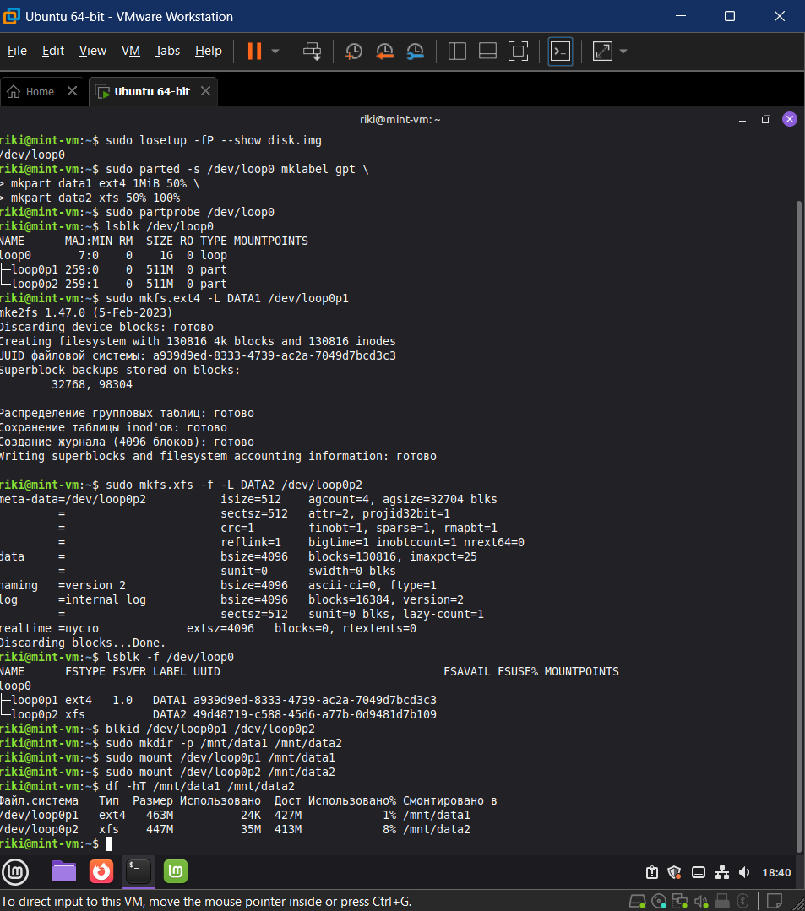

Задание 1. Создание диска, разметка, файловые системы

1. Создание образа и подключение
Я создал файл-образ размером 1 ГБ и подключил его как блочное устройство через loop-интерфейс:
```bash
cd ~
fallocate -l 1G disk.img
sudo losetup -fP --show disk.img
Вывод: /dev/loop0

2. Разметка GPT и создание разделов

Разметил диск таблицей GPT и создал два раздела по 50%:

sudo parted -s /dev/loop0 mklabel gpt \
mkpart data1 ext4 1MiB 50% \
mkpart data2 xfs 50% 100%
sudo partprobe /dev/loop0
lsblk /dev/loop0

Вывод lsblk:
NAME      MAJ:MIN RM SIZE RO TYPE MOUNTPOINTS
loop0       7:0    0   1G  0 loop 
├─loop0p1 259:0    0 511M  0 part 
└─loop0p2 259:1    0 511M  0 part

3. Создание файловых систем

Создал разные ФС на разделах с метками DATA1 и DATA2:
sudo mkfs.ext4 -L DATA1 /dev/loop0p1
sudo mkfs.xfs -f -L DATA2 /dev/loop0p2
lsblk -f /dev/loop0
blkid /dev/loop0p1 /dev/loop0p2

Вывод blkid:
/dev/loop0p1: LABEL="DATA1" UUID="a939d9ed-8333-4739-ac2a-7049d7bcd3c3" BLOCK_SIZE="4096" TYPE="ext4" PARTLABEL="data1" PARTUUID="..."
/dev/loop0p2: LABEL="DATA2" UUID="493d48719-c588-45d6-a77b-0d9481d7b109" BLOCK_SIZE="512" TYPE="xfs" PARTLABEL="data2" PARTUUID="..."

4. Монтирование и проверка

Подключил разделы и проверил занятость места:
sudo mkdir -p /mnt/data1 /mnt/data2
sudo mount /dev/loop0p1 /mnt/data1
sudo mount /dev/loop0p2 /mnt/data2
df -hT /mnt/data1 /mnt/data2

Вывод df -hT:
Файл.система Тип Размер Использовано Дост Использовано% Смонтировано в
/dev/loop0p1   ext4     463M          24K 427M            1% /mnt/data1
/dev/loop0p2   xfs      447M          35M 413M            8% /mnt/data2

5. Ответ на контрольный вопрос

Почему ext4-раздел сразу занят на 1%, хотя я ничего не записывал?
Файловая система ext4 резервирует место под служебные структуры при создании:

   1 Журнал (journal): Для обеспечения целостности данных при сбоях питания ext4 ведет журнал транзакций, который занимает фиксированный объем блоков.
   2 Таблицы inode и групповые дескрипторы: Система заранее выделяет место для хранения метаданных всех будущих файлов.
   3 Каталог lost+found: Создается автоматически для восстановления поврежденных файлов после проверки fsck.
   4 Резерв для root: По умолчанию 5% блоков резервируются для суперпользователя, чтобы система оставалась работоспособной даже при полном заполнении диска обычными пользователями.

XFS также занимает место (8%), но у неё другая структура метаданных (allocation groups), которая требует больше начального пространства для эффективного распределения.
