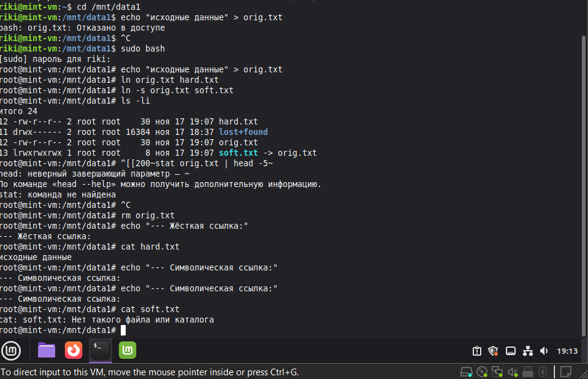

Задание 2. inode и ссылки

1. Создание ссылок и анализ inode

Я создал исходный файл, жёсткую и символическую ссылки в разделе `/mnt/data1`:
echo "исходные данные" > orig.txt
ln orig.txt hard.txt
ln -s orig.txt soft.txt
ls -li

Вывод ls -li:
итого 24
12 -rw-r--r-- 2 root root    30 ноя 17 19:07 hard.txt
11 drwx------ 2 root root 16384 ноя 17 18:37 lost+found
12 -rw-r--r-- 2 root root    30 ноя 17 19:07 orig.txt
13 lrwxrwxrwx 1 root root     8 ноя 17 19:07 soft.txt -> orig.txt

Анализ:

    Файлы orig.txt и hard.txt имеют одинаковый inode (12) и счётчик ссылок 2. Это подтверждает, что они являются разными именами для одного и того же физического блока данных.
    Файл soft.txt имеет свой собственный inode (13), тип файла l (link) и размер 8 байт (длина строки "orig.txt"). Он хранит только путь к цели, а не сами данные.

2. Эксперимент с удалением оригинала

Я удалил исходный файл и проверил доступность ссылок:
rm orig.txt
cat hard.txt
cat soft.txt

Вывод:
исходные данные
cat: soft.txt: Нет такого файла или каталога

3. Ответы на контрольные вопросы

Почему жёсткая ссылка пережила удаление, а символическая — нет?
Жёсткая ссылка — это прямая запись в каталоге, связывающая имя файла с его inode. Данные физически существуют на диске до тех пор, пока хотя бы одна жёсткая ссылка (или открытый дескриптор) указывает на этот inode. Удаление orig.txt лишь убрало одно имя, но inode 12 остался активным благодаря hard.txt.
Символическая ссылка — это отдельный файл специального типа, который содержит текстовую строку пути. При удалении orig.txt путь перестаёт вести к существующему объекту, и ссылка становится нерабочей («битой»). Сама символическая ссылка как файл существует, но она больше никуда не ведёт.
Почему жёсткую ссылку нельзя сделать на файл с другого раздела?
Номера inode уникальны только в пределах одной файловой системы (одного раздела). Каждый раздел имеет свою независимую таблицу inode. Если бы можно было создать жёсткую ссылку на другой раздел, ядро не знало бы, к какой именно таблице inode обращаться при попытке прочитать данные по этому номеру. Символические ссылки лишены этого ограничения, так как оперируют путями файловой системы, а не внутренними идентификаторами.

