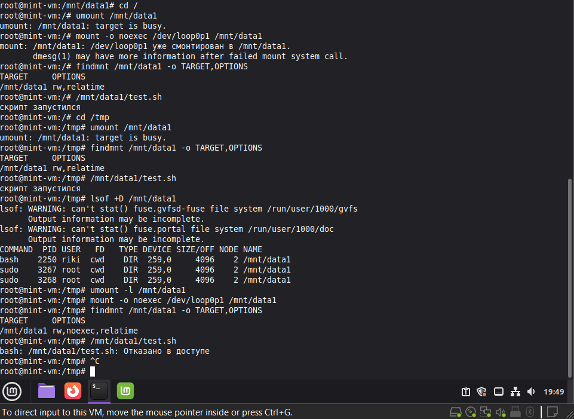

Задание 3. Монтирование и опция noexec

1. Проверка запуска до перемонтирования

Я создал тестовый скрипт в разделе `/mnt/data1` и убедился, что он выполняется:
printf '#!/bin/bash\necho "скрипт запустился"\n' > test.sh
chmod +x test.sh
./test.sh

Вывод:
скрипт запустился

2. Перемонтирование с запретом на исполнение

Раздел был занят процессами (bash и sudo), поэтому я использовал ленивое отмонтирование (-l) и затем подключил его с опцией noexec:

cd /tmp
umount -l /mnt/data1
mount -o noexec /dev/loop0p1 /mnt/data1
findmnt /mnt/data1 -o TARGET,OPTIONS

Вывод findmnt:
TARGET     OPTIONS
/mnt/data1 rw,noexec,relatime
Опция noexec успешно применена.

3. Попытка запуска после перемонтирования

Я попробовал запустить тот же скрипт, который имеет права на исполнение (+x):
/mnt/data1/test.sh
Вывод:
bash: /mnt/data1/test.sh: Отказано в доступе
Несмотря на наличие прав rwx, ядро запретило выполнение кода с этого раздела.

4. Ответы на контрольные вопросы

Как опция noexec защищает систему?
Опция noexec запрещает ядру загружать и исполнять любые двоичные файлы или интерпретировать скрипты (через shebang #!/...) с данного раздела. Это критически важная мера безопасности для каталогов, куда пользователи могут записывать файлы (например, /tmp, /var/tmp или пользовательские разделы). Даже если злоумышленник скачает вредоносный бинарник или скрипт и установит ему права +x, система не позволит его запустить.

Почему рекомендуются также опции nosuid и nodev для /tmp?

    nosuid: Запрещает установку битов SUID/SGID на файлах в этом разделе. Без этой опции злоумышленник мог бы создать программу с SUID-битом root, которая при запуске получала бы привилегии суперпользователя.
    nodev: Запрещает интерпретацию файлов как устройств (блочных или символьных). Это предотвращает создание поддельных устройств, через которые можно было бы получить прямой доступ к дискам или памяти системы.

Вместе эти три опции (noexec,nosuid,nodev) превращают временный каталог в безопасную «песочницу», где можно хранить данные, но нельзя выполнять код или повышать привилегии.
