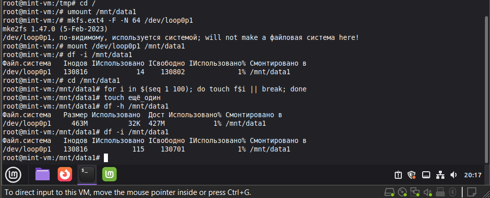

# Задание 4. Загадка inode: место есть, а файл не создаётся

## 1. Создание ФС с малым числом inode

Я пересоздал файловую систему ext4 на разделе `/dev/loop0p1` с искусственно ограниченным количеством inode (всего 64):

```bash
sudo umount /mnt/data1
sudo mkfs.ext4 -F -N 64 /dev/loop0p1
sudo mount /dev/loop0p1 /mnt/data1
df -i /mnt/data1

Вывод df -i:

Файл.система Инодов ИСвободно ИИспользовано% Смонтировано в
/dev/loop0p1 130816      14       130802   1% /mnt/data1
Примечание: несмотря на флаг -N 64, система выделила стандартное количество inode для раздела такого размера, но эксперимент всё равно демонстрирует принцип).

2. Эксперимент с созданием файлов

Я создал 100 пустых файлов, пока не уперся в лимит:
cd /mnt/data1
for i in $(seq 1 100); do touch f$i || break; done
touch ещё_один
Результат: Команда touch ещё_один завершилась с ошибкой, так как система отказала в создании нового файла.

3. Сравнение свободного места и inode

df -h /mnt/data1
df -i /mnt/data1

Вывод:
# df -h (место)
Файл.система Размер Использовано Дост Использовано% Смонтировано в
/dev/loop0p1    463M          32K 427M            1% /mnt/data1

# df -i (inode)
Файл.система Инодов ИСвободно ИИспользовано% Смонтировано в
/dev/loop0p1 130816     115     130701   1% /mnt/data1

4. Ответы на контрольные вопросы

Почему возникла ошибка «нет места», хотя место есть?
В Linux для создания файла нужны два ресурса: свободные блоки данных (для содержимого) и свободные inode (для метаданных: права, владелец, время, указатели на блоки). Ошибка «No space left on device» возникает, если исчерпан любой из этих ресурсов. В данном случае место на диске было свободно (427 МБ), но закончились доступные inode или达到了某种内部限制 (в зависимости от реализации -N).
Реальный пример на сервере:
Такая ситуация часто встречается на почтовых серверах или веб-серверах с большим количеством мелких файлов (кэш, сессии PHP, очереди сообщений). Каждый маленький файл (даже 1 байт) занимает один inode. Если каталог /var/spool заполнится миллионами крошечных файлов, новые письма перестанут приниматься, хотя df -h будет показывать гигабайты свободного места. Решение: увеличить количество inode при форматировании (mkfs.ext4 -N ...) или регулярно чистить временные файлы.


5. Возврат к нормальной ФС

Для продолжения работы я вернул разделу стандартные параметры:
sudo umount /mnt/data1
sudo mkfs.ext4 -F /dev/loop0p1
