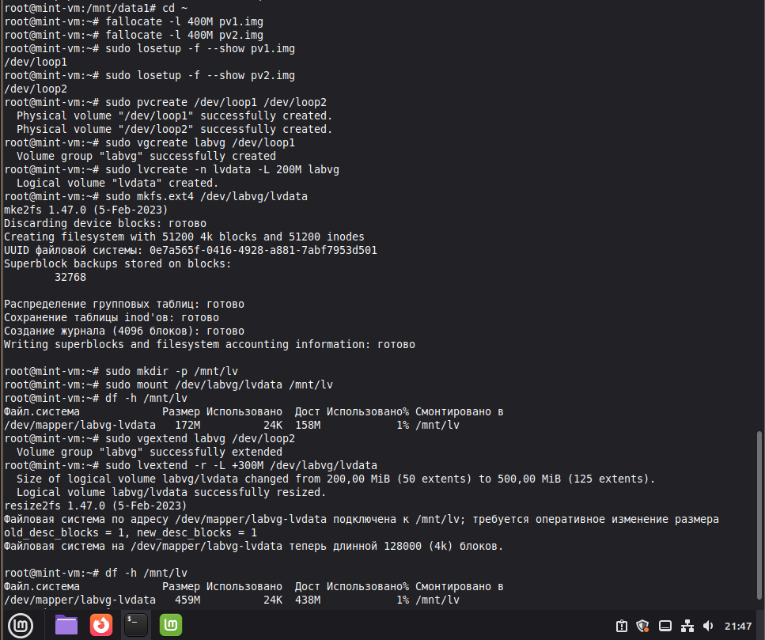

Задание 5. LVM: расширение тома на ходу

 1. Создание LVM-структуры

Я создал два образа по 400 МБ, подключил их как диски (/dev/loop1, /dev/loop2) и собрал гибкое хранилище:

sudo pvcreate /dev/loop1 /dev/loop2
sudo vgcreate labvg /dev/loop1
sudo lvcreate -n lvdata -L 200M labvg
sudo mkfs.ext4 /dev/labvg/lvdata
sudo mount /dev/labvg/lvdata /mnt/lv
df -h /mnt/lv

Вывод до расширения:
Файл.система             Размер Использовано  Дост Использовано% Cмонтировано в
/dev/mapper/labvg-lvdata   172M          24K  158M            1% /mnt/lv

2. Расширение тома без отключения

Когда место стало заканчиваться, я добавил второй диск в группу томов и расширил логический том на +300 МБ, не отмонтируя его:
sudo vgextend labvg /dev/loop2
sudo lvextend -r -L +300M /dev/labvg/lvdata
df -h /mnt/lv

Вывод после расширения:
Файл.система             Размер Использовано  Дост Использовано% Cмонтировано в
/dev/mapper/labvg-lvdata   459M          24K  438M            1% /mnt/lv
Размер увеличился с 172M до 459M мгновенно и прозрачно для приложений.

3. Ответы на контрольные вопросы

Что делает каждая команда LVM?
pvcreate: Инициализирует физический диск (или раздел) как Physical Volume (PV), добавляя в начало метаданные LVM.
vgcreate: Объединяет один или несколько PV в Volume Group (VG) — единый пул хранения.
lvcreate: Выделяет из VG Logical Volume (LV) — виртуальный «раздел», который можно форматировать и монтировать.
vgextend: Добавляет новый PV в существующую VG, увеличивая общий объём пула.
lvextend: Увеличивает размер LV за счёт свободного места в VG.

Зачем нужен ключ -r в lvextend?
Ключ -r (resize) автоматически вызывает resize2fs (для ext4) или xfs_growfs (для XFS) сразу после изменения размера LV. Без этого ключа логический том стал бы больше, но файловая система внутри него осталась бы прежнего размера, и новые блоки были бы недоступны. Приходилось бы выполнять команду изменения размера ФС отдельно, рискуя ошибиться.
Почему LVM лучше обычных разделов для сервера?
LVM абстрагирует файловую систему от физических дисков. Это позволяет:

 1 Расширять тома на ходу без простоев и перезагрузок.
 2 Легко добавлять новые диски в существующий пул (vgextend).
 3 Создавать снимки (snapshots) для резервного копирования без остановки сервисов.
 4 Перемещать данные между дисками онлайн (pvmove), например, при замене старого HDD на SSD.
    Обычные разделы жёстко привязаны к конкретному диску и размеру; их изменение требует отмонтирования, переразметки и риска потери данных.
