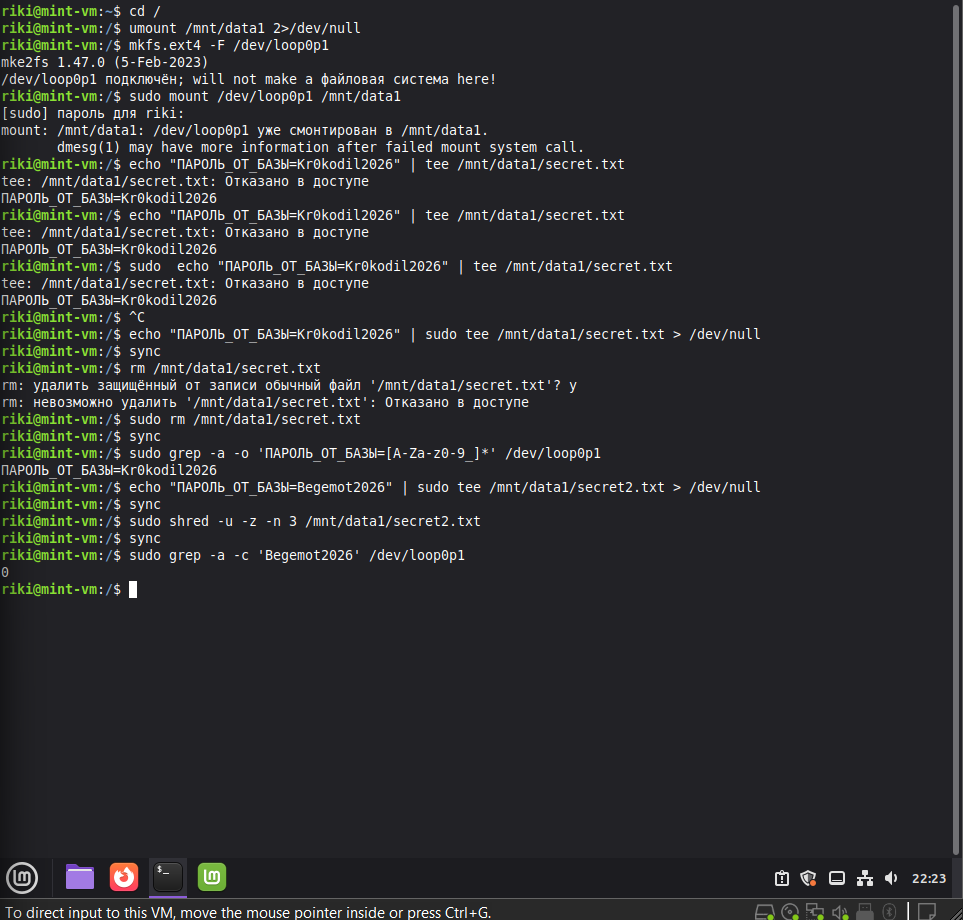

 Задание 6. Удалённый файл и его уничтожение

 Находим «удалённый» пароль

Я записал секрет в файл, удалил его командой rm и попытался найти данные напрямую на блочном устройстве, минуя файловую систему:

bash
echo "ПАРОЛЬ_ОТ_БАЗЫ=Kr0kodil2026" | sudo tee /mnt/data1/secret.txt > /dev/null
sync
sudo rm /mnt/data1/secret.txt
sync
sudo grep -a -o 'ПАРОЛЬ_ОТ_БАЗЫ=[A-Za-z0-9_]*' /dev/loop0p1

Вывод grep:
ПАРОЛЬ_ОТ_БАЗЫ=Kr0kodil2026
Результат: Пароль успешно найден. Команда rm лишь удалила запись о файле в каталоге и освободила inode, но сами данные остались в блоках диска до тех пор, пока они не будут перезаписаны новыми данными.

Безопасное уничтожение данных

Я создал новый файл с другим паролем и использовал утилиту shred для безопасного удаления:
echo "ПАРОЛЬ_ОТ_БАЗЫ=Begemot2026" | sudo tee /mnt/data1/secret2.txt > /dev/null
sync
sudo shred -u -z -n 3 /mnt/data1/secret2.txt
sync
sudo grep -a -c 'Begemot2026' /dev/loop0p1

Вывод grep:
0
Результат: Пароль не найден. shred перезаписал занимаемые файлом блоки случайными данными (3 прохода) и затем нулями (-z), после чего удалил файл (-u). Восстановление данных стало невозможным.

Ответы на контрольные вопросы
Что физически делает rm, а что — shred?

    rm: Удаляет ссылку на inode из каталога. Если счётчик ссылок становится равен 0, inode помечается как свободный, а блоки данных добавляются в список свободного пространства ФС. Сами биты на диске остаются неизменными до следующей записи в эти блоки.
    shred: Принудительно открывает файл и последовательно перезаписывает его содержимое заданным количеством проходов случайных данных и нулей. Только после этого вызывает системный вызов unlink (аналог rm). Это гарантирует, что даже при прямом чтении диска старые данные не будут обнаружены.

Почему на SSD вместо shred надёжнее шифровать весь диск?

Контроллер SSD использует механизм wear leveling (выравнивание износа): когда ОС просит перезаписать блок X, контроллер может физически записать новые данные в свободный блок Y, а старый блок X пометить для очистки позже. Поэтому shred, который пишет поверх старых логических адресов, может не затереть физические ячейки, где хранятся исходные данные. Единственный надёжный способ защиты данных на SSD — использование полнодискового шифрования (LUKS/FDE). При удалении ключа шифрования данные становятся криптографически недоступными мгновенно, независимо от физического расположения блоков.

Что делать со старым диском перед утилизацией?

Для HDD: Использовать shred -vzn 3 /dev/sdX или специализированные утилиты (DBAN) для многократной перезаписи всех секторов.
Для SSD: Использовать команду Secure Erase через BIOS/UEFI или утилиту производителя (например, Samsung Magician), которая подаёт напряжение на все ячейки памяти одновременно, сбрасывая их в заводское состояние.
Универсальный метод: Полнодисковое шифрование с момента установки системы. Перед продажей достаточно удалить ключ шифрования.
Физическое уничтожение: Для дисков с данными особой важности — механическое разрушение пластин или чипов памяти.
